

  

  
  
  

 

<h2 align="center">What I build</h2>

  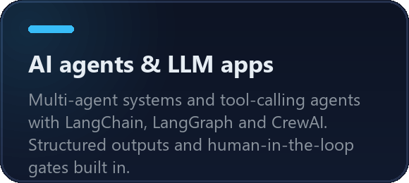
  
  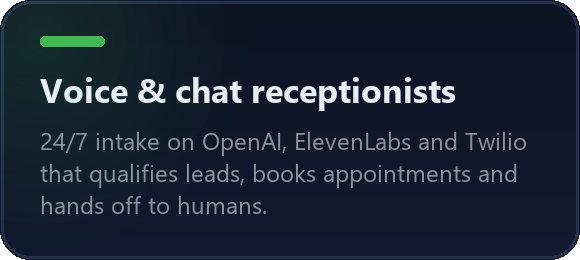
  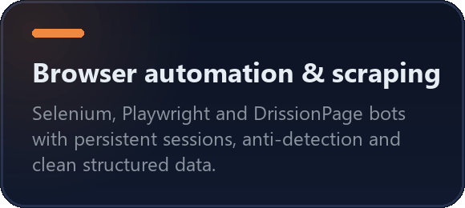
  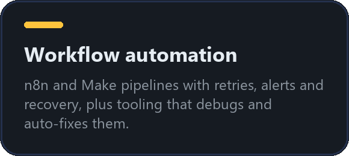
  

 

<h2 align="center">Featured work</h2>

Click a card to open the code.

  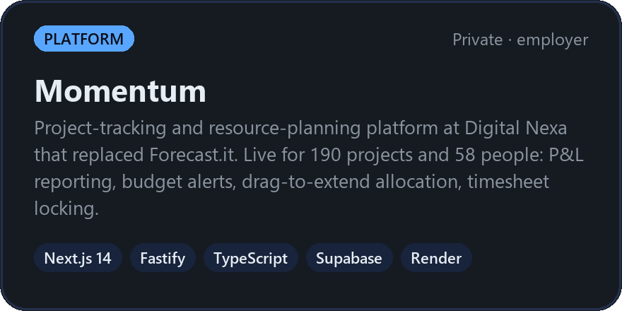
  <a href="https://github.com/haseeb9933/haseeb-portfolio/tree/main/Axon-Bridge">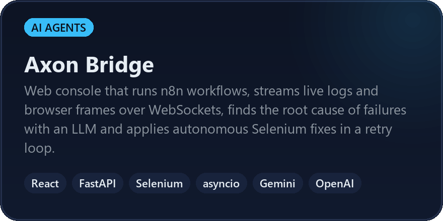</a>
  
  
  
  <a href="https://github.com/haseeb9933/haseeb-portfolio/tree/main/bidsquare">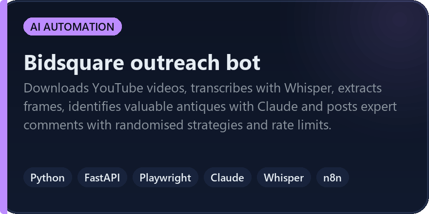</a>

 

<h2 align="center">More work</h2>

  
  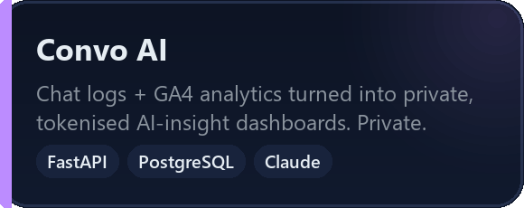
  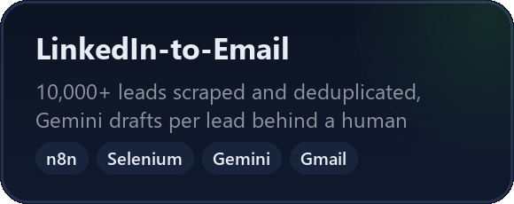
  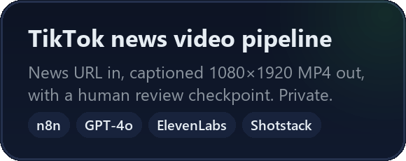
  <a href="https://github.com/haseeb9933/haseeb-portfolio/tree/main/linkedin--automation">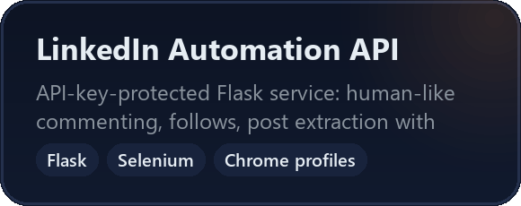</a>
  <a href="https://github.com/haseeb9933/tiktok-instagram-scraper">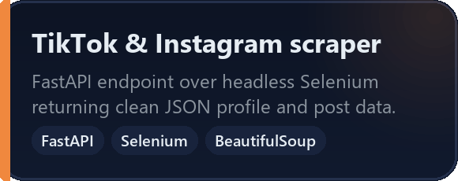</a>
  <a href="https://github.com/haseeb9933/Retail-Sales-Data-Dashboard">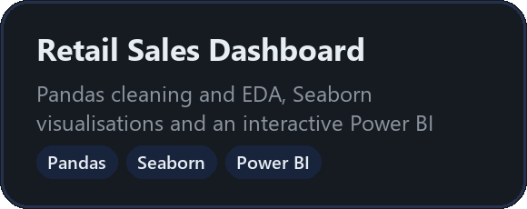</a>
  <a href="https://github.com/haseeb9933/Full_Stack_AI__Haseeb">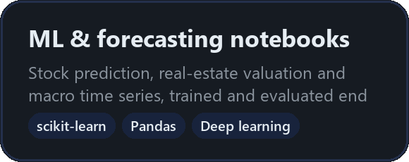</a>
  <a href="https://github.com/haseeb9933/3x-aiautomation-portfolio">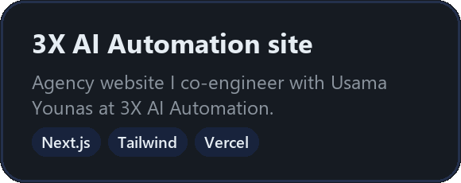</a>

Cards marked <i>Private</i> are employer or client builds. Everything in <a href="https://github.com/haseeb9933/haseeb-portfolio">haseeb-portfolio</a> ships with runnable code, an <code>.env.example</code> and full technical documentation.

 

<h2 align="center">Stack</h2>

  
  
  
  
  
  
  
  
   
  
  
  
  
  
  
  
  
   
  
  
  
  
  
  
  

 

<h2 align="center">Experience</h2>

  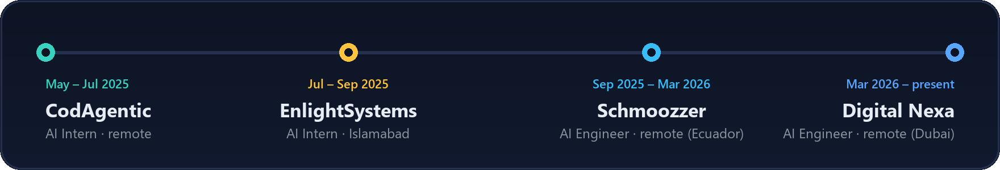

Also co-engineer at <b>3X AI Automation</b>, an AI automation agency, with Usama Younas.

 

<h2 align="center">Let's build something</h2>

  Open to full-time roles, contracts and freelance builds in AI agents, automation and full-stack AI products. 
  Send me the problem you are trying to solve and I will tell you straight whether I am the right fit.

  
  

